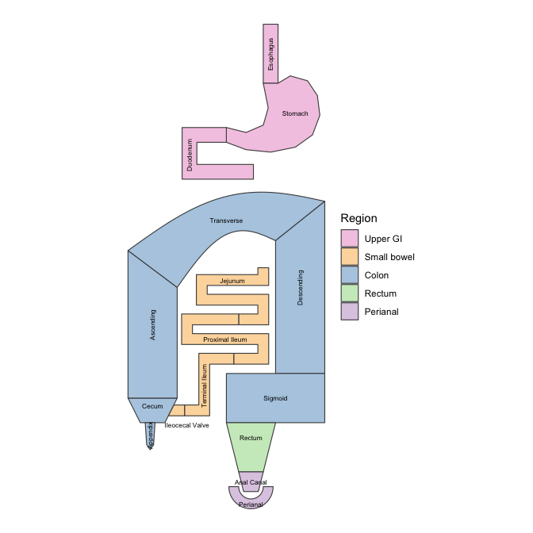
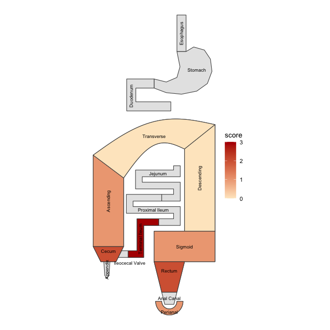

<!-- README.md is generated from README.Rmd. Please edit that file -->

# ggcolonviz

<!-- badges: start -->

<!-- badges: end -->

The goal of ggcolonviz is to provide a ggplot2 extension for visualizing
the colon, and with the `"ibd"` variant the whole gastrointestinal
tract, in a clear and informative way. It is designed for inflammatory
bowel disease (IBD) data: segment scores, Montreal disease location,
lesions, and changes over time.

## Installation

``` r
# install.packages("remotes")
remotes::install_github("Sanofi-Public/ggcolonviz")
```

## Quick start

See which segments exist, then colour them with your own per-segment
data:

``` r
library(ggcolonviz)

colon_map("ibd")
```



``` r
scores <- data.frame(
  part = c("Terminal ileum", "Cecum", "Ascending", "Transverse",
           "Descending", "Sigmoid", "Rectum", "Perianal"),
  score = c(3, 2, 1, 0, 0, 1, 2, 1)
)

colon_plot(scores, fill = score, variant = "ibd")
```



`colon_parts()` lists the valid segment names, `montreal_parts()`
translates Montreal codes (L1-L4, p, E1-E3) into segments, and
`colon_position()` places lesions on a segment. See
`vignette("IBD", package = "ggcolonviz")` for a step-by-step guide.

## Building plots layer by layer

For full control, use the `geom_colon()` and `geom_colon_label()` layers
directly:

``` r
library(ggcolonviz)
library(ggplot2)

patient_data <- data.frame(
  x = 0,
  y = 0,
  part = c(
    "Ileum",
    "Cecum",
    "Sigmoid",
    "Ascending",
    "Descending",
    "Transverse",
    "Rectum"
  )
)

patient_data |>
  ggplot(aes(x = x, y = y, part = part)) +
  geom_colon(
    color = "black",
    linewidth = 0.5,
    fill = "lightblue"
  ) +
  geom_colon_label() +
  coord_fixed() +
  theme_void()
```


## Contributing

Contributions are welcome! Please feel free to submit a pull request or
open an issue if you have any suggestions or find any bugs.

## Third-Party Licenses

This package imports [{sf}](https://cran.r-project.org/package=sf),
which is dual-licensed under GPL-2 and MIT. `ggcolonviz` uses `{sf}`
under the **MIT** branch of that dual license.
